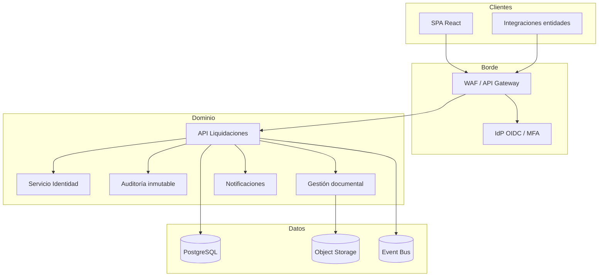

# Arquitectura objetivo — SILTGOV (referencia)

> Documento de **arquitectura prevista** para el sistema integral. La demo publicada implementa únicamente el **frontend**.

## Contexto de negocio

SILTGOV (Sistema Integrado de Liquidaciones Transparente del Gobierno Colombiano) centraliza el ciclo de vida de sentencias judiciales contra entidades públicas: registro, liquidación de intereses conforme a normativa colombiana, aprobación, pago y trazabilidad para control y transparencia.

## Vista de contenedores (objetivo)

## Calidad — ISO/IEC 25010

| Característica | Enfoque |
|----------------|---------|
| Adecuación funcional | Reglas de liquidación parametrizables, trazas por sentencia |
| Fiabilidad | Transacciones ACID, reintentos idempotentes en pagos |
| Usabilidad | WCAG 2.1 AA, i18n es-CO |
| Seguridad | OWASP ASVS L2, RBAC por rol oficina/entidad |
| Mantenibilidad | DDD modular, OpenAPI versionada |
| Portabilidad | Contenedores, IaC |

## Seguridad (OWASP)

- Autenticación federada + MFA (TOTP/WebAuthn)
- Autorización ABAC/RBAC alineada a oficina y entidad
- Validación server-side, rate limiting, CSP estricta en SPA
- Auditoría append-only con hash encadenado
- Cifrado en tránsito (TLS 1.3) y en reposo (KMS)

## Stack backend previsto

- **API:** Node.js (NestJS) o Java (Spring Boot) — REST + OpenAPI 3.1
- **BD:** PostgreSQL 16, migraciones Flyway/Liquibase
- **Mensajería:** RabbitMQ o Kafka para eventos de liquidación
- **Observabilidad:** OpenTelemetry, Prometheus, Grafana

## Frontend (esta demo)

- React + Vite, despliegue estático (GitHub Pages / CDN)
- Integración futura: cliente HTTP tipado desde OpenAPI, PKCE contra IdP
